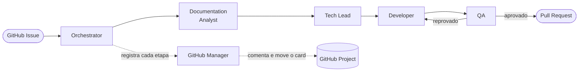

# SmartDesk AI Team

Sistema de gerenciamento de chamados (help desk) **construído por um time de agentes de IA** no Claude Code. Cada funcionalidade nasce de uma GitHub Issue e percorre um pipeline com papéis separados — análise, arquitetura, desenvolvimento, QA e gestão do GitHub — até virar um Pull Request.

O produto é o SmartDesk; **o processo é a demonstração**: rastreável, repetível e com cada decisão registrada na própria Issue.


---

## O pipeline de agentes



| Agente | Responsabilidade | Skill |
|---|---|---|
| `orchestrator` | Interpreta a Issue, coordena a ordem das etapas e decide quando uma etapa terminou | `analyze-task` |
| `documentation-analyst` | Levanta contexto e requisitos a partir da documentação e do código | `documentation-analysis` |
| `tech-lead` | Define a solução técnica, os arquivos impactados e a estratégia de testes | `implementation-planning` |
| `developer` | Implementa o plano, sem expandir escopo | `code-development` |
| `qa` | Valida contra os critérios de aceite; aprova ou devolve com apontamentos | `qa-validation` |
| `github-manager` | **Único** agente que fala com o GitHub: comenta a Issue, move o card no Project, fecha a Issue quando o orchestrator pede | `github-management` |

Princípios que o pipeline impõe:

- **Cada agente só faz o seu papel.** Quem planeja não codifica; quem valida não corrige.
- **Decisões grandes são explicadas antes de implementadas.** Mudança de modelo de dados, nova arquitetura ou dependência pausa o fluxo para confirmação.
- **O PR nunca fecha a Issue sozinho** (sem `Closes #N`): fechar é decisão do orchestrator, executada pelo github-manager. Nenhum agente faz merge.

Definições em [`.claude/agents/`](.claude/agents) e [`.claude/skills/`](.claude/skills). Fluxo detalhado em [`docs/development-workflow.md`](docs/development-workflow.md).

## O que o SmartDesk faz

Todas as funcionalidades abaixo foram entregues pelo pipeline, uma Issue por vez.

- **Central de atendimento** — tela principal orientada à ação: indicadores clicáveis (críticos, em andamento, aguardando, resolvidos), seção **"Precisa da sua atenção"** com pontuação objetiva, cards com ações rápidas de status e prioridade, busca por título ou por frase (*"chamados críticos do desenvolvimento"*) e filtros combináveis. Inclui estados de carregamento (skeleton), vazio e erro com "tentar novamente".
- **Chamados** — criação com prioridade e equipe obrigatórias; edição de status, prioridade, equipe e responsável.
- **Equipes e responsáveis** — 4 equipes, cada uma com seus membros. Trocar a equipe remove automaticamente um responsável que não pertença a ela: o sistema nunca guarda uma combinação inválida.
- **Dashboard** — totais, distribuição por status e prioridade, chamados recentes, busca e filtros.
- **Kanban** — chamados em colunas por status.
- **Assistente de criação** — sugere título e prioridade a partir da descrição; o usuário aplica ou descarta.
- **Notificações** — sino com contagem de não lidas e painel de eventos (chamado criado, atualizado, concluído).

## Decisões de engenharia que valem destacar

- **Sem backend, de propósito.** Os dados ficam em memória e espelhados no `localStorage`. Todo acesso passa por `src/store/`; trocar por uma API é uma mudança contida em dois arquivos.
- **"IA" sem chamar API externa.** O assistente de criação e a busca por linguagem natural usam heurísticas locais, isoladas em `src/lib/`. A razão: expor uma chave de LLM no navegador seria inseguro, e criar um backend só para isso contradiria a decisão acima. A interface foi desenhada para que um provedor de IA substitua a heurística sem reescrever os componentes.
- **Regras de negócio fora da interface.** Pontuação de atenção, filtros, estatísticas e interpretação de busca são funções puras em `src/lib/`.
- **Migração de dados no carregamento.** Quando o modelo ganhou campos obrigatórios, chamados antigos foram normalizados na leitura do storage em vez de descartados.
- **Acessibilidade básica:** `aria-pressed` nos indicadores, `role="alert"` nos erros, `aria-busy` no carregamento, foco visível e informação que não depende só de cor.

Detalhes e justificativas em [`docs/architecture.md`](docs/architecture.md).

## Como executar

Requisitos: Node.js 18+ e npm.

```bash
npm install
npm run dev      # http://localhost:5173
```

| Comando | O que faz |
|---|---|
| `npm run dev` | Servidor de desenvolvimento com hot reload |
| `npm run build` | Verifica os tipos e gera o build de produção em `dist/` |
| `npm run preview` | Serve localmente o build de produção |
| `npm run typecheck` | Apenas a verificação de tipos |

## Estrutura

```
.claude/
├── agents/     6 agentes do pipeline
└── skills/     1 skill por agente
docs/           visão do projeto, arquitetura e fluxo de desenvolvimento
src/
├── components/ UI (cada componente com seu CSS Module)
├── lib/        regras de negócio puras (atenção, filtros, busca, equipes)
├── store/      estado dos chamados e persistência
└── types/      tipos do domínio
```

## Limitações conhecidas

Para ser direto sobre o estado atual:

- **Não há testes automatizados.** A validação foi feita pelo agente de QA (testes funcionais no navegador, nos três tamanhos de tela) e por `tsc` + build. Uma suíte (Vitest + Testing Library) é o próximo passo natural.
- **Sem backend, autenticação ou multiusuário** — os dados são locais a cada navegador.
- **Responsáveis são uma lista fixa** em código, não um cadastro de usuários.

## Próximos passos

- Suíte de testes automatizados para as regras em `src/lib/`.
- API real no lugar do `localStorage` (a fronteira já existe em `src/store/`).
- Provedor de IA real para o assistente e a busca, atrás da interface atual.
- Movimentar chamados por arrastar-e-soltar no Kanban.
